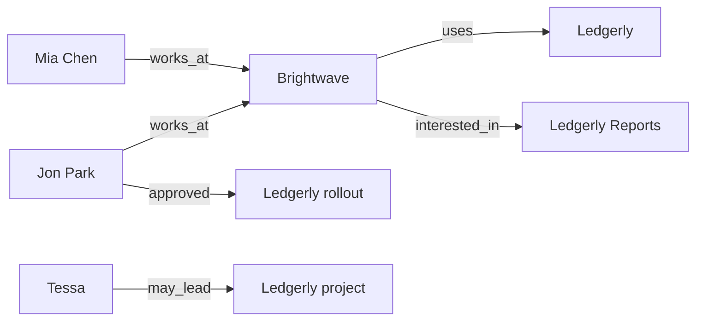

# Knowledge graph extraction

A knowledge graph is a set of statements of the form subject–predicate–object ("Acme Corp — uses — Ledgerly"), the same three-part shape as a W3C RDF triple. It is only useful if each statement can be traced to a source sentence and the same thing always has the same name. So every triple here carries its quote and a confidence level, and duplicates are merged before anything is drawn.

## When to use

- Turning meeting notes, contracts, CRM notes, or reports into a map of people, companies, products, and how they relate.
- Preparing a CSV to import into a graph tool (Neo4j, Kumu, a spreadsheet pivot) or a RAG system.
- Answering "who is connected to what?" across many documents.
- Not for designing the classes and rules of a domain from scratch: use ontology-draft first if the entity types aren't known.

## What you need

- The documents, or pasted text. Number them (D1, D2...) so each triple can cite its source.
- The entity types and relationships that matter. If not given, propose 4 to 8 entity types and 5 to 10 predicates from a first read, mark them "[proposal]", and continue.
- Any existing list of canonical names (customer list, staff directory). If none, build one in step 4.

## Steps

1. **Fix the entity types and predicates first.** Write them as a short list: types in singular nouns (Person, Company, Product, Project), predicates as lowercase verb phrases (works_at, uses, owns, reports_to). Use one predicate per meaning; "employed by" and "works at" both become works_at.
2. **Extract triples sentence by sentence.** Only what a sentence states. Each triple: subject, predicate, object, the exact source quote (under 25 words), the document and location. Don't infer relationships from proximity ("mentioned in the same paragraph" is not a relationship).
3. **Grade confidence.** High: stated directly ("Mia leads Project Orbit"). Medium: stated but hedged or indirect ("Mia seems to be running Orbit now"). Low: implied by context. Our default: keep low-confidence triples in the table but out of the diagram.
4. **Merge duplicates into canonical names.** Group variants ("Acme", "ACME Corp.", "Acme Corporation") under one canonical name and record the aliases. Different things with the same name get a qualifier ("Mercury (project)", "Mercury (vendor)"). When unsure whether two names are the same entity, keep them separate and list the question.
5. **Check for conflicts.** Two triples that can't both be true (Mia reports_to Jon; Mia reports_to Ana) are flagged with both sources and dates. Prefer the newer source only if the documents are dated; otherwise leave it open.
6. **Write the outputs.** An entity table, a triple table in CSV-ready form (no merged cells, one row per triple), and a Mermaid flowchart of high and medium triples. In Mermaid, put labels with spaces or parentheses in double quotes, and never use the bare word "end" as a node id.

## Output format

````markdown
## Entities
| id | canonical_name | type | aliases |
|---|---|---|---|
| E1 | [name] | [type] | [alias; alias] |

## Triples
| subject | predicate | object | confidence | source_quote | source |
|---|---|---|---|---|---|
| [canonical name] | [predicate] | [canonical name] | high/medium/low | "[exact quote]" | D[n], [section/line] |

## Diagram (high and medium only)
```mermaid
flowchart LR
  E1["[name]"] -->|[predicate]| E2["[name]"]
```

## Open questions
- [Possible duplicate / conflict / unclear relationship], sources D[n], D[n]
````

## Example

**Input:**
D1 (call notes, 3 May): "Mia Chen from Brightwave said they've rolled out Ledgerly to their finance team. Their CFO, Jon Park, signed off."
D2 (email, 10 May): "BrightWave Inc. wants to add Ledgerly Reports. Mia mentioned Tessa might take over the project."

**Output:**

````markdown
## Entities
| id | canonical_name | type | aliases |
|---|---|---|---|
| E1 | Brightwave | Company | BrightWave Inc. |
| E2 | Mia Chen | Person | Mia |
| E3 | Jon Park | Person | |
| E4 | Ledgerly | Product | |
| E5 | Ledgerly Reports | Product | |
| E6 | Tessa | Person | |
| E7 | Ledgerly rollout | Project | |
| E8 | Ledgerly project | Project | |

## Triples
| subject | predicate | object | confidence | source_quote | source |
|---|---|---|---|---|---|
| Mia Chen | works_at | Brightwave | high | "Mia Chen from Brightwave" | D1, line 1 |
| Brightwave | uses | Ledgerly | high | "they've rolled out Ledgerly to their finance team" | D1, line 1 |
| Jon Park | works_at | Brightwave | high | "Their CFO, Jon Park" | D1, line 2 |
| Jon Park | approved | Ledgerly rollout | high | "Jon Park, signed off" | D1, line 2 |
| Brightwave | interested_in | Ledgerly Reports | high | "wants to add Ledgerly Reports" | D2, line 1 |
| Tessa | may_lead | Ledgerly project | medium | "Tessa might take over the project" | D2, line 2 |

## Diagram (high and medium only)


## Open questions
- Does Tessa work at Brightwave or at our company? D2 doesn't say.
- "Ledgerly rollout" and "Ledgerly project" may be the same project; kept separate.
````

## Checks before you send

- [ ] Every triple has an exact quote that appears in the cited document.
- [ ] Each real-world entity appears under one canonical name, with aliases listed.
- [ ] Each meaning uses one predicate; no two predicates mean the same thing.
- [ ] The diagram contains only high and medium triples and renders as valid Mermaid.
- [ ] Possible duplicates and conflicts are listed as open questions, not silently merged.

## Common mistakes

- Treating co-occurrence as a relationship. Two names in one paragraph aren't linked unless a sentence says how.
- Letting the predicate list grow to 40 near-synonyms. Merge them before extracting.
- Drawing every triple. A diagram with more than about 30 edges is unreadable; split it by entity or type.
